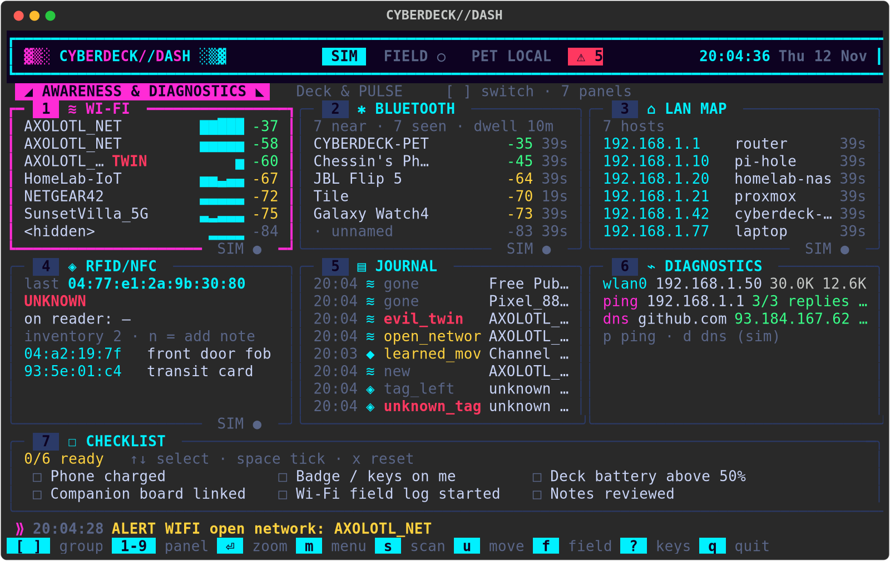

# CYBERDECK / MAIN

Simulation-first software for the main Raspberry Pi Zero 2 W
cyberdeck: a custom full-screen terminal interface (not the Pi OS
desktop) that talks to a companion board running a Digimon-style pet.

Everything runs on a normal Linux/macOS terminal today. No Pi is
required. **One interface** does everything: the Rich dashboard look
(awareness panels, PULSE, system) with every main-deck feature as tabs
(command console, dungeon with PULSE, notes & todo, fun & tools).



## Run it

From this directory:

```bash
pip install -r requirements-dash.txt   # once: Rich, for the interface

# The interface (sim sensors + sim radios + PULSE)
python3 -m cyberdeck
python3 -m cyberdeck --theme amber --tab console

# The original curses interface (standard library only)
python3 -m cyberdeck --classic

# Headless: type commands, or pipe them in
python3 -m cyberdeck --headless
printf 'status\nping\npet status\nquit\n' | python3 -m cyberdeck --headless

# Headless, one-shot scripts (repeat --script as needed)
python3 -m cyberdeck --headless --script 'help' --script 'ping' --script 'pet status'
```

Tabs: **Awareness & Diagnostics**, **Deck & PULSE**, **Console**,
**Dungeon**, **Notes & Todo**, **Fun & Tools**. `[` `]` switch tabs,
`:` jumps to the console, `?` lists the keys, `q` quits. The full guide
(keys per tab, adding a tab, panel or command) is
[docs/DASHBOARD.md](docs/DASHBOARD.md). Without Rich installed,
`python3 -m cyberdeck` falls back to `--classic` with a hint.
`python3 -m cyberdeck_dash` is an alias for `python3 -m cyberdeck`.

`--mode sim` is the default. You can also set `CYBERDECK_MODE=sim`.
`--mode real` selects the Pi sensors and real radio backends. The
companion link is `[link] mode` in `config/hardware.ini`: `auto` (the
default: the companion program if it is already running, else the
built-in sim pet), `sim`, `tcp` or `serial` (`/dev/serial0`); `--link`
overrides it. See "Deck + pet on one computer" below.

```bash
python3 -m cyberdeck --help
```

## Tests

```bash
python3 -m unittest discover -s tests -v
```

## Layout

```text
config/dash.ini         the interface: tabs, panels, themes, awareness settings
config/hardware.ini     companion link (auto/sim/tcp/serial), GPIO, buzzer
config/keys.ini         hotkeys + the launcher / Fun & Tools list (both UIs)
config/theme.ini        colors for --classic (curses)
config/layout.ini       prompt, history, features on/off, --classic layout
plugins/hello.py        example user command (auto-loaded)
plugins/_template.py    copy this to add your own command
cyberdeck/              the deck's brain (commands, features, link) + the classic UI
cyberdeck_dash/         the Rich interface (tabs, panels, the bridge to cyberdeck/)
docs/DASHBOARD.md       the interface guide: tabs, keys, adding a tab or panel
docs/PROTOCOL.md        dual-board message protocol
docs/ARCHITECTURE.md    how modules fit together
docs/screenshot.txt     captured text snapshot of the UI
docs/TESTING_TWO_BOARDS.md  running deck + pet together (TCP, serial, two Pis)
tools/fake_companion.py stand-in pet server for testing the link
companion/              the companion board's own app (the real pet; its own README)
CUSTOMIZING.md          how to change colors, layout, and commands
tests/                  unit tests
```

## Deck + pet on one computer

The real pet lives in `companion/`, the companion board's app. It is
maintained separately; see [companion/README.md](companion/README.md).
To run both together, open two terminals in this directory:

```bash
cd companion && python3 companion.py --tcp 127.0.0.1:7777   # terminal 1: the pet
python3 -m cyberdeck                                        # terminal 2: the deck
```

With the default `[link] mode = auto` the deck uses the companion if it
is already running, so start the pet first (the header shows `LINK ◆`;
`LINK ◆ SIM` means the built-in sim pet). `--link tcp` instead waits for
the companion and keeps retrying, so then the order does not matter.
Change the address with `--host` / `--port` or `[link]` in
`config/hardware.ini`.

No companion checkout handy? `tools/fake_companion.py` is a stand-in
that speaks the same protocol:

```bash
python3 tools/fake_companion.py          # terminal 1: fake pet (TCP 127.0.0.1:7777)
python3 -m cyberdeck --link tcp          # terminal 2: the deck
```

Rest, sleep, evolution and dungeon combat are specified by the companion
in [companion/docs/DUNGEON_INTEGRATION.md](companion/docs/DUNGEON_INTEGRATION.md)
(summarised in [docs/PROTOCOL.md](docs/PROTOCOL.md)). Add
`--evolution-speed 50` to `companion.py` to see evolution sooner.

The companion's own tests run from its folder:
`cd companion && python3 -m unittest discover -s tests -v`.

Serial and two-Pi setups: [docs/TESTING_TWO_BOARDS.md](docs/TESTING_TWO_BOARDS.md).

## What it can do

Type `help` in the Console tab for everything, or press F2 for the
launcher menu.

- **Awareness & Diagnostics:** Wi-Fi, Bluetooth, LAN map, RFID/NFC,
  discovery journal, ping/DNS/interface stats, checklist, field mode;
  every first find feeds PULSE XP (`pet.discovery`).
- **Core:** one tabbed interface, launcher (F2), hotkeys (`keys`),
  history (Up/Down, `history`), Tab completion. (`--classic`: split
  panes or tabs, `view`, `layout`, F4/F6.)
- **Productivity and network:** `note`, `todo`, `wifi scan`/`wifi meter`,
  `net info`, `ping`, `net port`, `net check`, `ssh <name>`.
- **Pet and hardware:** `pet` (feed/play/rest/sleep/evolve/avatar/log/
  alerts/gift), an animated face and evolution progress in the pet pane,
  evolution pop-ups, hunger and boredom alerts, `gpio led|set|read|beep`,
  `music play <song>` on the buzzer.
- **Fun:** boot animation, ticker visualizer, deck moods, `hack`,
  `typehack`, `dungeon` (PULSE fights at your side with its real stats;
  loot can be gifted to it; `loot add <item>` for scripts).
- **Outside world:** `weather`, `sun`, `moon`, `iss` (passes over you,
  computed on the deck), plus a `sky` panel.

## Customize

This scaffold is meant to be edited. Start with
[CUSTOMIZING.md](CUSTOMIZING.md): colors and layout are INI files,
and new commands are just Python files dropped into `plugins/`.

## Roadmap

Next steps after this scaffold:

1. **Real UART link** — done in `cyberdeck/link.py`; still to verify on
   two real Pis (docs/TESTING_TWO_BOARDS.md part C).
2. **Pi deployment** — run this package on the main Pi Zero 2 W,
   point `--mode real` at the live sysfs sensors and the serial
   port, and confirm the curses UI on the deck's own screen.
3. **Boot-to-UI** — start the deck interface automatically on boot
   (a systemd service or getty) instead of a graphical desktop.

## Protocol (short)

Boards exchange newline-delimited JSON objects with three keys:
`type`, `id`, and `payload`. Requests and replies share the same
`id`. Types include `hello`, `ping`, `pet.status`, `pet.feed`,
`pet.play`, `pet.gift`, `pet.rest`/`sleep`/`evolve`, `pet.combat.*`,
`pet.discovery`, plus their `*.ok` replies, `pet.event` pushes and
`error`. Full rules are in [docs/PROTOCOL.md](docs/PROTOCOL.md).

## The interface in one paragraph

`cyberdeck/` is the deck's brain (commands, features, the companion
link, the sim pet) and never draws anything itself. Two front ends show
it: `cyberdeck_dash/` (Rich, the default) and `cyberdeck/tui.py`
(curses, `--classic`). Both use the same commands, files in `data/`,
plugins and companion link, so a note added in one is there in the
other. The awareness panels listen passively to your own surroundings
and your own subnet, for personal use only (not a skimmer detector).
Guide: [docs/DASHBOARD.md](docs/DASHBOARD.md). How the pieces fit:
[docs/ARCHITECTURE.md](docs/ARCHITECTURE.md).
