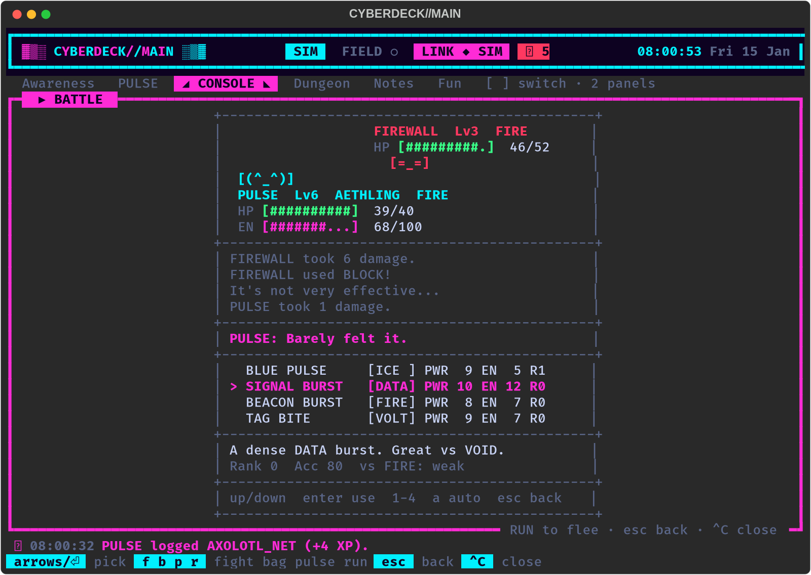

# Dungeon battles (FIGHT / BAG / PULSE / RUN)

In plain English: in the dungeon, walking into an enemy (or an enemy
walking into you) no longer swaps punches on the map. The screen turns
into a Pokemon-style battle, and PULSE, your companion pet, does the
fighting. You take turns with the enemy until one side drops, or you run.



The screen is plain ASCII and exactly 48 columns wide, so it looks the
same in the unified Rich interface, in `--classic` curses mode, and as
text in `--headless` scripts:

```
+----------------------------------------------+
|                   BUG  Lv2  DATA             |   the enemy (top right):
|                   HP [######....]  13/22     |   name, level, type, HP bar, face
|                     (o_o)                    |
|  [(^_^)]                                     |   PULSE (bottom left):
|  PULSE  Lv3  AETHLING  FIRE                  |   face, name, level, species, type
|  HP [##########]  28/28                      |
|  EN [########..]  80/100                     |
+----------------------------------------------+
| PULSE used PECK!                             |   the battle log
| BUG took 9 damage.                           |
| BUG used BYTE NIBBLE!                        |
| It's not very effective...                   |
+----------------------------------------------+
| PULSE: Barely felt it.                       |   what PULSE says, on its own row
+----------------------------------------------+
| > FIGHT          BAG                         |   the 2x2 menu
|   PULSE          RUN                         |
+----------------------------------------------+
| arrows move  enter pick  f b p r  1-4 move   |   the keys for this screen
+----------------------------------------------+
```

PULSE's lines can be 44 characters long. They get a `PULSE: ` in front
only when that still fits (37 characters or less); longer ones are shown
bare. The newest line also goes to the 16x2 LCD (see below).

## Controls

| Where | Keys | What happens |
|---|---|---|
| Any log page | any key | next page of the log, then the menu |
| Menu | arrows / WASD / hjkl, Enter or Space | move the `>` and pick |
| Menu | `f` `b` `p` `r` | FIGHT, BAG, PULSE, RUN straight away |
| Menu | `1`-`4` | use that move straight away |
| FIGHT | Up / Down, Enter | pick a move. The bottom rows show its description, rank, accuracy, and how well it works against this enemy's type (`super`, `normal`, `weak`, `immune`) |
| FIGHT | `1`-`4` | use that move |
| FIGHT | `a` | let PULSE pick (it picks the best move for this enemy's type) |
| BAG | Up / Down, Enter | use an item. Greyed-out items (an evo chip) can't be used in battle |
| Menu | `p` (or pick PULSE) | PULSE's card: HP, EN, mood, status, attack/defense/speed, run chance |
| PULSE card | Enter or `s` | **STATS**: the full PULSE STATS sheet (8 pages, see [DASHBOARD.md](DASHBOARD.md#pulse-stats-every-stat-on-8-pages)). Free: no turn used, the enemy waits |
| STATS | Left / Right (h / l), `1`-`8`, Up / Down, Esc / `q` | flip pages, jump, scroll a long page, back to the PULSE card |
| FIGHT / BAG / PULSE | Esc, Backspace, `q` | back to the menu |
| Menu | `q` / Esc | nothing: you can't quit mid-battle. Pick RUN |
| End screen | any key | back to the dungeon |
| Anywhere | Ctrl+C | close the dungeon (an open battle counts as running away) |

A move PULSE can't afford is marked `LOW EN`. You can still
pick it: the companion then uses its fallback (Chirp, or Guard).

## A turn

1. **You pick.** FIGHT sends `pet.combat.action`. PULSE may hit, miss,
   crit, find a weakness, or (if it is grumpy) throw a tantrum and waste
   the turn. The deck takes the damage off the enemy's HP.
2. **The enemy answers** (if it is still standing). The deck picks its
   attack and rolls the base damage. The companion works out what PULSE
   actually takes after its defense and type (`pet.combat.hit`).
3. BAG items also use up your turn, unless they would do nothing (full
   HP, for example). The PULSE card and its STATS sheet are free.

## How it ends

- **Win:** the enemy is deleted from the map, your score goes up as
  before, PULSE gets XP (`2 + 3 x floor`, x3 for a boss), and there is a
  chance of loot for PULSE's battle bag. The victory screen shows the
  XP, PULSE's level, bond, any loot and any new move. Loot you pick up
  on the map still goes in your own loot bag (`loot`), as before.
- **PULSE faints:** you are sent back to the dungeon and PULSE comes
  home with 1 HP and the (sad) mood the companion sends. The enemy stays
  where it is and leaves you alone for a few turns. `pet rest` heals.
- **Run:** the deck rolls the odds:
  `0.5 + (PULSE speed - enemy speed) x 0.05 + (PULSE level - enemy level) x 0.05`,
  kept between 10% and 95%, and halved against a boss. If you fail, the
  enemy gets a free turn. If you get away, the enemy waits a few turns.

If PULSE can't battle (the link is down, it is asleep, it has fainted, or
it is an older companion with no combat at all), walking into an enemy
is the old bump fight with your own fists.

## Enemies

| Map | Enemy | Type | Weak to | First floor | Face |
|---|---|---|---|---|---|
| `b` | bug | DATA | VOLT | 1 | `(o_o)` |
| `g` | glitch | VOID | DATA | 1 | `(#_#)` |
| `s` | spam | NET | FIRE | 1 | `(^o^)` |
| `v` | virus | DATA | FIRE | 2 | `(>_<)` |
| `l` | lag | ICE | VOLT | 2 | `(-_-)` |
| `w` | worm | NET | ICE | 3 | `(~o~)` |
| `F` | firewall | FIRE | ICE | 3 | `[=_=]` |
| `D` | daemon | VOID | DATA | 4 | ``(`_')`` |
| `K` | kernel panic (boss, every 5th floor, near the stairs) | VOID | DATA | 5 | `(X_X)` |

The seven types are NORM, VOLT, DATA, NET, FIRE, ICE and VOID. The type
chart is the companion's (it sends it with `pet.combat.roster`); the
deck's copy in `cyberdeck/battledata.py` is only used with a companion
that doesn't send one. Two immunities to remember: NET does nothing to
VOID, and FIRE does nothing to FIRE (a firewall can't burn).

The enemy AI is simple: most of the time (`smart = 0.6`) it uses the
attack that hurts PULSE's type most, otherwise a random one of its
attacks. Each enemy's attacks are in the ROSTER table.

## Make it yours

- `config/battle.ini`: flee odds, enemy damage, how smart enemies are,
  XP, loot chance, and one `[enemy.<id>]` section per enemy to change
  its face, map letter, type, stats, first floor, or to switch it off.
- `cyberdeck/battledata.py`: the full tables (roster, attacks, items,
  the sim pet's lines). Every line PULSE says must be ASCII and at most
  44 characters; `tests/test_battle.py` checks.
- `config/fx.ini [dungeon] battle = no` brings back the old crawl where
  PULSE fights next to you on the map.
- `config/lcd.ini [notify] battle = no` keeps battle lines off the LCD.

## The LCD

Each new battle line becomes a PULSE blurb on the 16x2 LCD and a short
pop-up titled `VS <ENEMY>`. Pop-ups follow the same rate limits as every
other notification (`[filter]` in `config/lcd.ini`), and only the newest
battle line waits in the queue, so a fast fight never floods the screen.

## Battles without the dungeon

`battle <enemy> [level]` starts a battle on its own, for example
`battle kernel panic 3`. In the full-screen interfaces it opens the same
screen. In `--headless` scripts you play it with commands:

```bash
python3 -m cyberdeck --headless --script "battle firewall 3" \
    --script "battle fight 2" --script "battle bag 1" --script "battle pulse" \
    --script "battle auto" --script "battle run" --script "battle show"
```

| Command | Does |
|---|---|
| `battle fight <n or name>` | use move n (1-4) or a move by name |
| `battle auto` | let PULSE pick |
| `battle bag` / `battle bag <n or name>` | list the bag / use an item |
| `battle pulse` | PULSE's card |
| `battle stats [page]` | the PULSE STATS sheet (all pages, or one); no turn used |
| `battle run` | try to run |
| `battle show` | print the whole 48-column screen |
| `battle end` | stop (counts as running away) |

## Protocol and the sim pet

The messages are the companion's contract, in
[companion/docs/DUNGEON_INTEGRATION.md](../companion/docs/DUNGEON_INTEGRATION.md)
("Battle protocol"), summed up in [PROTOCOL.md](PROTOCOL.md):
`pet.combat.stats {enemy}` starts a battle, then `pet.combat.action`,
`pet.combat.hit`, `pet.combat.item`, and `pet.combat.end`.
`pet.combat.roster` (asked once per run) gives the type chart,
`pet.combat.run` the companion's lines for running away, and
`pet.combat.moves` / `pet.inventory` change the loadout and the bag.

Older companions still work: anything they leave out falls back to a
default. Moves without a type are NORM, every matchup is x1, the deck
writes the log lines itself, and BAG says there is no bag.

The built-in sim pet (`cyberdeck/companion.py`, used with `--link sim`
and by the tests) speaks the same battle protocol, so you can try all of
this without the companion Pi.
