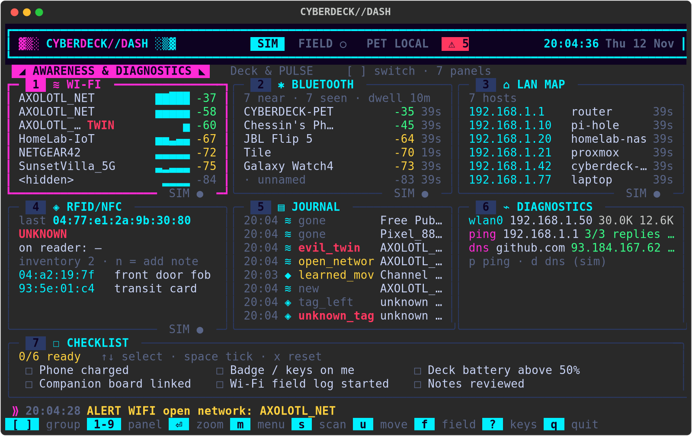

# CYBERDECK//MAIN: the one interface

The dashboard and the main deck are now **one program**. `python3 -m
cyberdeck` opens a full-screen, cyberdeck-styled Rich interface for the
**main** Pi Zero 2 W: the awareness dashboard you already know, plus every
feature of the original deck (command console, dungeon with PULSE,
notes and todo, typing hack, hack show, weather, ISS, music, GPIO, SSH,
plugins…) as tabs on the same screen. The Rich code lives in
`cyberdeck_dash/`; the deck's logic stays in `cyberdeck/` and is reused,
not copied.

It is **simulation-first**: on any Linux/macOS computer every radio is
simulated with realistic, changing data (including the occasional
anomaly). On the Pi, `--mode real` switches each scanner to its real
backend, with hooks for the built-in Wi-Fi/Bluetooth radios, the
MFRC522 RFID reader and GPIO buttons.

> **Awareness tools only.** Everything here listens passively to your
> own surroundings and your own subnet, for personal, educational use.
> Nothing joins, probes, deauths or attacks anyone's network or device.
> A flag ("evil twin", "unknown tag") is a hint to look closer, not
> proof. These are **not skimmer detectors**.



More pictures: [Dungeon tab, mid-run](dashboard_dungeon.png) ·
[Console tab](dashboard_console.png) · plain text (100x30):
[dashboard_snapshot.txt](dashboard_snapshot.txt)

## Run it

```bash
pip install -r requirements-dash.txt        # just Rich
python3 -m cyberdeck                        # sim mode, any computer
python3 -m cyberdeck --theme amber          # neon | amber | matrix (t cycles live)
python3 -m cyberdeck --tab dungeon          # open on a tab (console, dungeon, notes, fun, wifi…)
python3 -m cyberdeck --no-companion         # built-in sim pet (same as --link sim)
python3 -m cyberdeck --mode real            # on the Pi: real sensors + backends from config/dash.ini
python3 -m cyberdeck --classic              # the original curses interface
python3 -m cyberdeck --script 'pet status'  # headless / scripts, unchanged
```

`python3 -m cyberdeck_dash` still works: it is now an alias for
`python3 -m cyberdeck` (same flags). If Rich is not installed,
`python3 -m cyberdeck` prints a hint and starts the classic UI.

With the PULSE companion (same computer, two terminals):

```bash
cd companion && python3 companion.py --tcp 127.0.0.1:7777   # window 1 (start it first)
python3 -m cyberdeck                                        # window 2 (header shows LINK ◆)
```

`config/hardware.ini [link] mode = auto` (the default) uses the companion
if it is already listening when the deck starts, otherwise the built-in
sim pet (`LINK ◆ SIM`). `--link tcp` waits and keeps retrying instead;
`--port 7791` picks another port; `--link serial` is the UART between two
Pis. There is **one** companion connection for the whole interface:
discovery XP, the PULSE panels, pet commands and PULSE in the dungeon all
use it.

Docs pictures (no terminal needed):

```bash
python3 -m cyberdeck --snapshot docs/dashboard --seed 7
python3 -m cyberdeck --snapshot docs/dashboard_dungeon --seed 7 --tab dungeon --keys enter,right,right,down
python3 -m cyberdeck --snapshot docs/dashboard_console --seed 7 --tab console
```

Tests: `python3 -m unittest discover -s tests/dash -t .`
(the full repo suite `python3 -m unittest discover -s tests` includes them).

## Screen layout

```
header   ▓▒░ CYBERDECK//MAIN ░▒▓   SIM  FIELD ○  LINK ◆  ⚠ 3  ! HUNGRY    12:05:09
tabs     ◢ AWARENESS & DIAGNOSTICS ◣  PULSE  Console  Dungeon  Notes  Fun
body     grid of panel tiles (focused one glows), or one panel full-screen,
         or a deck activity (dungeon, typehack, hack, boot, launcher)
footer   ⟫ latest alert / log / deck notice              visualizer ▂▃▅▃
         key hints (they change on the Console tab and inside activities)
```

Panels are grouped into **tabs** (set in `[tabs]` / `[tab.*]` of
`config/dash.ini`):

| Tab | Panels | What it is for |
|-----|--------|----------------|
| **Awareness & Diagnostics** | Wi-Fi, Bluetooth, LAN map, RFID/NFC, Journal, Diagnostics, Checklist | passive awareness + ping/DNS |
| **Deck & PULSE** | Field mode, PULSE, LCD 16x2, System | field mode, PULSE's discovery side, the 16x2 LCD, system health |
| **Console** | Console, PULSE (face) | the deck's command line: every command and plugin |
| **Dungeon** | Dungeon, PULSE combat, Loot bag | start a run, PULSE's real combat sheet, gift loot |
| **Notes & Todo** | Notes, Todo | `data/notes.txt`, `data/todo.txt` (same files as the commands) |
| **Fun & Tools** | Fun & Tools list, Sky, Music, Net, Output | every launcher entry (keys.ini `[launcher]`) one Enter away |

## Keys (and buttons)

Everywhere (except while typing in the Console):

| Key | Does |
|-----|------|
| `[` `]` (or `g`) | switch tab |
| `1`-`9` | focus a panel in the current tab |
| `←` `→` `tab` / `↑` `↓` | move focus (on list panels `↑` `↓` pick a row) |
| `enter` / `z` | full-screen view of the focused panel, `esc` back (on Dungeon / Fun lists: run) |
| `:` | jump to the Console and type a command |
| `F1`-`F12`, `ctrl+o`… | hotkeys from `config/keys.ini` (F2 launcher, F11 dungeon, F12 typehack…) |
| `m` | main menu (grouped by tab, with ping / DNS / console / launcher items) |
| `s` | scan now (focused scanner, or all) |
| `u` / `v` | PULSE uses the selected move (runs a fresh scan) / next move |
| `f` | field mode on/off |
| `p` / `d` | ping a host / DNS lookup (Diagnostics) |
| `r` / `n` | sim: "tap" an RFID tag / add a note to the last tag |
| `space` / `x` | tick a checklist item / reset the list |
| `t` | next theme |
| `?` | key help |
| `q` | quit |

Per tab:

| Where | Keys |
|-------|------|
| **Console** | type a command, `enter` run, `tab` complete, `↑` `↓` history, `PgUp` `PgDn` scroll, `esc` clear the line, `ctrl+a/e/u/l` like the classic prompt. Letters type (so `q` does not quit: use `quit`). `[` `]` switch tabs only when the line is empty. |
| **Dungeon** | `enter`/`space` start a run. In the run every key goes to the game: arrows/wasd/hjkl move, `>` stairs, `1`-`9` PULSE's move on its turn, `space` auto, `.` rest, `g` gift, `i` bag, `q`/`esc` leave. |
| **Loot bag** | `↑` `↓` pick, `g` gift to PULSE, `x` drop |
| **Notes** | `a` (or `n`) add, `↑` `↓` pick, `x` delete |
| **Todo** | `a` (or `n`) add, `↑` `↓` pick, `space` done/undo, `x` delete, `c` clear done |
| **Fun & Tools** | `↑` `↓` pick, `enter` run (result in OUTPUT; entries ending in `...` go to the console to finish typing) |
| any activity | all keys go to it; `ctrl+c` always closes it |

## Panel guide

**Awareness & Diagnostics**

- **Wi-Fi** (`rules.WifiTracker`): every network by BSSID with signal,
  security and a sparkline of its RSSI history. Logs new networks and
  names, open networks, sudden signal jumps (`rssi_jump_db`), and
  networks that disappear or come back. Highlights:
  `TWIN` your own SSID (from `[wifi] trusted`) coming from an unlisted
  radio, or an open copy of an encrypted network's name;
  `BAIT` names matching `suspicious_patterns` ("free wifi", "guest", ...);
  `OPEN` no encryption.
- **Bluetooth** (`rules.BtTracker`): unique MACs, names, RSSI and how
  long each has been around. A **new** device that stays at least
  `dwell_minutes` raises one HIGH alert. Your own devices go in `known`.
  Many phones rotate their MAC, so treat it as a hint.
- **LAN map** (`rules.LanTracker`): hosts on your own subnet from the
  ARP table (`/proc/net/arp`), plus an optional, rate-limited ping
  sweep (`ping_sweep = yes`). The sweep refuses anything but a private
  /24 or smaller. New hosts and an IP whose MAC changed are flagged.
- **RFID/NFC** (`rules.RfidTracker`): last UID read, tags currently on
  the reader, the inventory of known UIDs with notes (`data/tags.json`),
  an **unknown-tag alert**, and a presence log (how long each tag was
  held and how many reads). `n` attaches a note to the last tag.
- **Journal** (`journal.Journal`): every finding, timestamped, appended
  to `data/discoveries.jsonl`, one JSON object per line:
  `{"ts","epoch","source":"dash","kind","event","id","label","interest","detail"}`.
  The main deck or the companion can read the same file later.
- **Diagnostics** (`diag.Diagnostics`): interface traffic (rx/tx rates
  and totals from `/proc/net/dev`) with IP addresses, plus `p` ping a
  host (`ping -c 3`) and `d` DNS lookup (`socket.getaddrinfo`). Both
  run on a background thread. Simulated in sim mode (`[diag] backend`).
- **Checklist**: reminders from `[checklist] items`.

**Deck & PULSE**

- **Field mode** (`field.AlertFilter`): `f` (or the field button)
  speeds scans up to `[field] scan_interval` and only alerts on HIGH
  findings. Every alert passes a per-item cooldown and a token-bucket
  rate limit (`max_alerts_per_minute`, `burst`). Manual scans have
  their own cooldown. Everything still goes to the journal.
- **PULSE**: name, species, level, XP, energy, environment mood and
  buff (and, when linked, the companion's `busy` 0–1 meter), the
  selected move (with rank / bonus when `pet.combat.stats` has them),
  recently learned or strengthened moves, the last discovery reaction,
  and alerts pushed by the companion (`pet.event`, including
  `move_strengthened`). Header `LINK ◆` = the companion program,
  `LINK ◆ SIM` = the deck's built-in sim pet, `LINK DOWN` = waiting for
  it (the panel then uses a local stand-in for XP).
- **LCD 16x2**: what the little I2C LCD shows right now (the real one on
  the Pi, or the simulated one), its backlight, how many notifications
  wait, and (zoomed) the last ones shown and the ones skipped. Alerts,
  discovery reactions and field mode feed it. Console: `lcd test`,
  `lcd say <text>`, `lcd backlight on|off|auto`, `lcd status`.
  Setup: [LCD.md](LCD.md).
- **System**: CPU, memory, temperature (`~` = simulated off-Pi), load,
  uptime, disk, and each scanner's backend and schedule.

## How it fits together

```
ScanWorker threads ─► ScanResult ─► rules.*Tracker ─► Finding
                                                        │ EventBus "finding"
               ┌───────────────┬──────────────┬─────────┴──────────┐
            Journal      PetAdapter (XP)   activity → mood   AlertFilter
           (JSONL)     the deck's one link                       │ "alert"
                                                         ticker · alert LED
```

| File | Role |
|------|------|
| `cyberdeck_dash/__main__.py` | alias: `python3 -m cyberdeck_dash` = `python3 -m cyberdeck` |
| `unified.py` | builds Dashboard + DeckBridge, the Rich Live loop, `--snapshot` |
| `deck_bridge.py` | the main deck minus curses: console, history, Tab completion, activities, jobs, notices |
| `shared_link.py` | one companion link: the deck's, with events copied to deck + dashboard |
| `app.py` | the Dashboard: state, scheduling, keys, bus wiring, deck key routing |
| `events.py` | `Finding`, interest levels, `EventBus` |
| `rules.py` | Wi-Fi / BT / LAN / RFID trackers, XP + move rules, mood |
| `scanners/` | `base.py` interface + Sim/Real backends per radio |
| `pet.py` | companion TCP client, local pet, `pet.discovery` (see companion/docs/DISCOVERY.md) |
| `field.py`, `ratelimit.py` | alert filter, cooldown, token bucket |
| `journal.py` | shared discovery journal |
| `diag.py` | ping / DNS / interface stats |
| `sysinfo.py` | CPU / memory / temperature from /proc and /sys |
| `inputs.py` | non-blocking keyboard, gpiozero buttons, alert LED |
| `ui/theme.py`, `ui/panels.py`, `ui/screen.py` | look, panels, layout |
| `ui/deck_panels.py` | console, dungeon, combat, loot, notes, todo, fun & tools, sky/music/net |
| `ui/rows.py` | draws the deck's `(text, role)` rows in the Rich theme |

The deck side (all in `cyberdeck/`, shared with `--classic` and
`--headless`): `commands.py` (the registry), `features/*` (every
feature), `activity.py` (full-screen modes), `jobs.py`, `history.py`,
`completion.py`, `link.py` / `companion.py` (the companion link and the
sim pet), `panes.py` (PULSE / sky / music / net / todo panes).

```
keys ─► Dashboard.handle_key ─┬─ activity open?  ─► DeckBridge.activity_key ─► Activity.on_key
                              ├─ keys.ini hotkey ─► DeckBridge.run_action
                              ├─ Console tile    ─► DeckBridge.console_key ─► Registry.dispatch
                              ├─ notes/todo/loot/launcher/dungeon tile ─► deck commands
                              └─ everything else ─► the dashboard keys (scan, field, menu…)
```

## PULSE tie-ins (Digimon side)

When the companion is linked, **it** decides XP and moves. The
dashboard sends `pet.discovery` for each first sighting and treats
`pet.discovery.ok` as the source of truth (XP, reaction, learned or
strengthened move, level-up). The full message is specified in
[companion/docs/DISCOVERY.md](../companion/docs/DISCOVERY.md). The
`[xp]` rules below are used only when the companion is unlinked, or
when it answers `unknown_type`.

- **First sightings earn XP**: `[xp]` sets the local-fallback base per
  kind (`wifi`, `bt`, `lan`, `rfid`) plus `interest_bonus` per level
  above low. The companion's table is the same (wifi 4/7/10, bt and
  lan 3/6/9, rfid 8/11/14). Repeats of the same kind+id come back with
  XP 0 and an "already logged" reaction. A sleeping PULSE still records
  the find, at half XP and with no move changes.
- **Moves**: each first sighting has `learn_chance × interest` to teach
  PULSE a move from that scanner's pool (`rules.MOVE_POOL`), or to
  strengthen one it already knows (rank capped at 5, +2 power per rank).
- **Use move** (`u`, or the use-move button) runs a fresh scan of the
  scanner the move belongs to (`Signal Sniff` → Wi-Fi, `Tag Bite` →
  RFID, companion moves are matched by keyword, otherwise all).
- **Mood/buffs**: while linked, the PULSE panel shows the companion's
  `environment` (`busy` 0–1 and `buff`: calm, curious, busy airwaves,
  or bored). Offline, the dashboard's own activity window is used:
  calm (energy regen), curious, buzzing (XP ×1.25), alert (2+
  high-interest finds).

## Hardware hooks (real mode)

Set `mode = real` in `[dash]` or pass `--mode real`. Each section's
`backend` picks the real implementation; missing tools or libraries
show an error in that panel instead of crashing.

| Section | Real backends | Notes |
|---------|---------------|-------|
| `[wifi]` | `nmcli` (normal user), `iw` (needs root) | listen-only scan list |
| `[bluetooth]` | `bluetoothctl`, `bleak` (`pip install bleak`) | passive adverts |
| `[lan]` | `proc` (+ `ping_sweep = yes`) | own private subnet only |
| `[rfid]` | `mfrc522` (`pip install mfrc522 spidev`) | enable SPI in raspi-config |
| `[diag]` | `auto` / `real` / `sim` | ping, getaddrinfo, /proc/net/dev |
| `[buttons]` | `gpiozero` | BCM pins, pull-up, press = key |

MFRC522 wiring (SPI0): SDA→GPIO8 (CE0, pin 24), SCK→GPIO11 (pin 23),
MOSI→GPIO10 (pin 19), MISO→GPIO9 (pin 21), RST→GPIO25 (pin 22),
GND→GND, 3.3V→3.3V (**not 5 V**).

Buttons (`[buttons]`, wire each between the pin and GND): `scan`=17,
`use_move`=27, `field`=22, `next_panel`=23, optional joystick
`joy_up/down/left/right/press`, optional `alert_led`. Each press acts
exactly like its key (`s`, `u`, `f`, `tab`, arrows, `enter`), so
everything is testable on a keyboard first.

## Customizing

The look and the tabs are in `config/dash.ini`: themes (`[theme.NAME]`,
any `#rrggbb`; they colour the deck's panes and games too), the logo
text (`[dash] title`), tabs and which panels they hold (`columns`,
`ratios`, `short`, `detail`), scan intervals, thresholds
(`rssi_jump_db`, `dwell_minutes`, cooldowns, rate limits), suspicious
name patterns, your trusted networks and known devices, checklist items,
XP numbers and the button pins.

The deck's own settings are unchanged and shared by both front ends:
`hardware.ini` (companion link, GPIO, buzzer), `keys.ini` (hotkeys and
the launcher list, which is also the Fun & Tools list), `layout.ini`
(prompt, history size, `[features] disabled`), `world.ini`, `fx.ini`
(dungeon size, PULSE options, boot), `moods.ini`, `hosts.ini`,
`pet.ini`. `theme.ini` only colours `--classic`.

## Add a tab

Write a section in `config/dash.ini` and add its key to `[tabs] order`:

```ini
[tabs]
order = awareness, deck, console, dungeon, notes, fun, mine

[tab.mine]
title = My Bench
short = Bench
panels = todo, sky, console
columns = 2
ratios = 1, 1
detail = yes
```

Any panel key from either list works (see the comment above `[tabs]`).

## Add a command (shows up in the Console)

Drop a file in `plugins/` (copy `plugins/_template.py`). It appears in
`help`, Tab completion and the Console straight away, and in headless
mode. To put it in the Fun & Tools list too, add a line to `[launcher]`
in `config/keys.ini` (`My thing = mycommand`); to give it a key, add it
to `[hotkeys]` (`F9 = mycommand`). A command that sets
`ctx.activity = MyActivity()` gets the whole body of the screen, exactly
like the dungeon (see `cyberdeck/activity.py`).

## Add a panel

1. In `cyberdeck_dash/ui/panels.py` (or `ui/deck_panels.py` for a panel
   that uses the deck: `dash.bridge.ctx` is the deck's Context) write a
   function that reads the Dashboard and returns a Rich renderable:
   ```python
   def render_uptime(dash, big: bool):
       return Text(f"up {dash.sysinfo.get('uptime', 0) / 3600:.1f} h", style=dash.theme.accent)
   ```
2. Register it: `PANELS["uptime"] = ("UPTIME", "⏱", render_uptime, None)`.
3. Add `uptime` to a tab's `panels =` list in `config/dash.ini`.

A pane you already wrote for the classic deck (`register_pane()` in
`cyberdeck/panes.py`) can be shown as is: add
`"mine": ("MINE", "★", deck_pane("mine"), None)` to `DECK_PANELS` in
`ui/deck_panels.py` and `"mine"` to `DECK_PANEL_KEYS` in `app.py`.

## Add a scanner

1. In `cyberdeck_dash/scanners/` subclass `Scanner`, set `name`, and
   return a `ScanResult` of records from `scan()` (a `Sim` class and a
   real class, importing optional libraries inside the method).
2. Pick it in `scanners/__init__.py:build_scanners()` from a config key.
3. Add a tracker in `rules.py` that turns records into `Finding`s, and
   route it in `Dashboard.handle_result()`. The journal, XP, mood and
   alerts then work automatically through the event bus.

## Protocol: `pet.discovery`

The interface reuses the existing newline-JSON protocol
(`docs/PROTOCOL.md`, `cyberdeck/protocol.py`) over the deck's one link
(sim, TCP or UART): the deck's `hello` with `"events": true`,
`pet.status` polling, and `pet.event` pushes shown as alerts (including the
new `move_strengthened` `{move, rank, bonus}` event).

`pet.discovery` is **implemented** on both sides, and the deck's
built-in sim pet (`--link sim`, or `auto` with no companion running)
answers it with the same rules, so there is only ever one PULSE. The authoritative
spec is [companion/docs/DISCOVERY.md](../companion/docs/DISCOVERY.md).
A short copy of the shape:

### `pet.discovery` → `pet.discovery.ok`

Sent once per **first sighting** (new network, device, host or tag).

```json
{"type":"pet.discovery","id":"…","payload":{"kind":"rfid","id":"de:ad:10:ca","interest":3,"event":"unknown_tag","label":"unknown tag"}}
{"type":"pet.discovery.ok","id":"…","payload":{"xp":14,"level":4,"level_up":false,"learned_move":"Tag Bite","strengthened_move":null,"reaction":"PULSE learned Tag Bite from unknown tag!","pet":{…pet object, including environment…}}}
```

| Request field | Meaning |
|---------------|---------|
| `kind` | `wifi`, `bt`, `lan`, `rfid` |
| `id` | BSSID, MAC, IP or tag UID |
| `interest` | 1 low, 2 medium, 3 high (clamped; default 1) |
| `event`, `label` | optional: which rule fired, a display name |

| Reply field | Meaning |
|-------------|---------|
| `xp` | XP awarded (0 on a repeat) |
| `learned_move` / `strengthened_move` | move name or `null` |
| `reaction` | one line shown on the ticker and in the journal |
| `level`, `level_up`, `pet` | refresh the PULSE panel (`pet` includes `environment`) |

The companion decides XP and moves itself. Repeats of the same
kind+id are not an error: the reply is still `pet.discovery.ok` with
`xp: 0` and an "already logged" reaction. An `error` with
`unknown_type` makes the dashboard stop sending it and fall back to
its local XP rules, so older companions keep working and `proto`
stays `1`. Other errors (timeout, `bad_payload`) do not invent local
XP.
