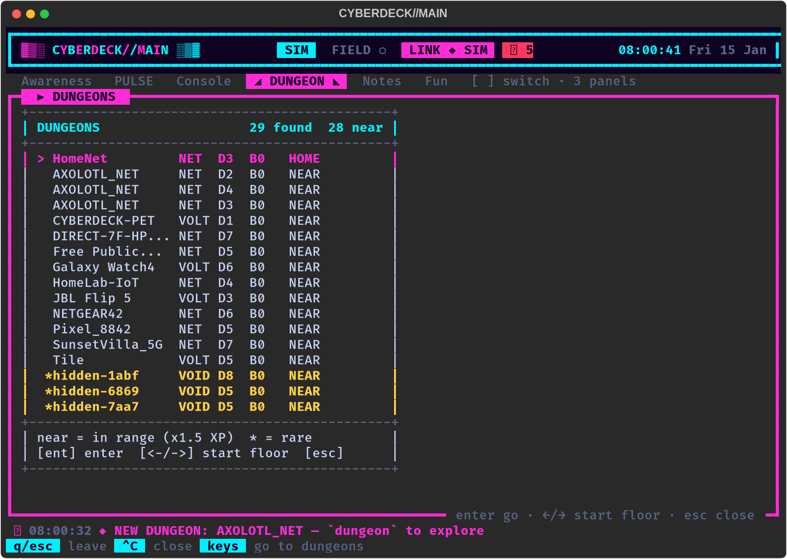

# Network dungeons

In plain English: every Wi-Fi network, Bluetooth device and LAN device
PULSE has discovered unlocks a dungeon named after it. `dungeon` opens a
picker of those dungeons. Pick one and the deck builds its floors, one at
a time, from the seed the companion gives it. The companion owns the
list, the seeds, progress and rewards. The deck owns the map, movement
and fights.

It is a game built on your own discovery journal. Nothing joins, probes
or touches any network: a dungeon is just a name and a few numbers the
companion derived from a sighting. Raw MAC addresses / BSSIDs are never
shown or logged; a nameless signal is called `hidden-xxxx`.

The contract is the companion's, in
[companion/docs/DUNGEON_INTEGRATION.md](../companion/docs/DUNGEON_INTEGRATION.md)
("Network dungeons"). That document wins if anything here disagrees.



## Controls

| Where | Key | Does |
|---|---|---|
| Picker | up/down, j/k | choose a dungeon |
| Picker | left/right | choose the start floor: 1 or an unlocked checkpoint (6, 11, ...) |
| Picker | enter | go in |
| Picker | c | the classic random dungeon |
| Picker | esc / q | close |
| Floor banner | any key | start the floor |
| Floor | arrows / wasd / hjkl | move; walk into an enemy to battle ([BATTLE.md](BATTLE.md)) |
| Floor | `>` (on the stairs) | next floor |
| Floor | g / i | gift the newest loot / the bag |
| Floor | q / esc | leave the dungeon (the run ends, "fled") |
| End screen | any key | back to the picker |

Commands (Console tab, `--headless` scripts):

```text
dungeon                  the picker (or the classic dungeon, see "Fallback")
dungeon list             the picker as text
dungeon enter <n> [F]    enter dungeon n (or a name), from start floor F
dungeon classic          the classic random dungeon
dungeons                 same as `dungeon list`
```

## The picker

48 columns, as in the spec's mockup. Each row is the name, the type
(`NET`, `VOLT`, `VOID`...), `D` difficulty, `B` the deepest floor
reached, and `HOME` (your home network) or `NEAR` (in range now: x1.5
battle XP). `*` marks a rare dungeon. Order: home first, then in range,
then deepest. The chosen start floor shows at the end of the selected
row (`F11`).

## Floors

- **Map:** built from `random.Random(f"{seed}:{floor}")` and the
  companion's `layout` (size, rooms, corridor style, loops, dark, traps,
  items). Bad or missing numbers fall back to defaults and are capped by
  `config/dungeons.ini [map]`. Same seed and floor, same map, every time.
- **Look:** wall / floor characters and the palette come from the
  dungeon's `theme` (`[dungeons] glyphs` and `colors` turn them off).
  Dark floors only show what is near you.
- **Map symbols:** `@` you, `>` stairs, letters are enemies, `*` an item
  for PULSE's bag, `$` a data chest (extra XP), `!` a repair kit, `^` a
  trap (hidden until you are next to it or step on it).
- **Stairs:** each floor opens with a banner (`B3F  CafeNet-5G`, the
  enemy levels). With every enemy beaten the floor counts as `cleared`,
  otherwise `stairs`. The deck sends `pet.dungeon.floor`, shows PULSE's
  line, then the next floor's banner.
- **Bosses:** every 5th floor, always kernel panic with the dungeon's own
  title (e.g. "KERNEL PANIC: VOID LORD"), next to the stairs, with a boss
  banner.
- **Checkpoints:** floors 1, 6, 11, ... (the floor after each boss). A
  requested start floor snaps down to the nearest unlocked checkpoint.
- **End of a run:** leaving (`fled`) or fainting (you or PULSE) ends the
  run (`next` is null). The next run can start at the last checkpoint.

## XP (no double counting)

- Battle XP only ever comes from `pet.combat.end`. In a network dungeon
  it carries `dungeon_id` and `floor`, so the companion applies the x1.5
  in-range bonus (its reply's `xp_mult`; the win screen says
  "In range: x1.5 XP!").
- `pet.dungeon.floor`'s `xp` is only the extras: data chests
  (`chest_xp` + the floor number each). Never battle XP.
- `loot` lists the bag items picked up on the floor; `enemies` the
  enemies beaten; `boss_beaten` is sent on boss floors.

## New-dungeon alerts

`dungeon_found` / `dungeons_found` (pushed `pet.event`, or the `dungeon`
field of a `pet.discovery.ok` reply) show "NEW DUNGEON: name" in the
console and the pet log / discovery journal, and pop up on the LCD
(`{diamond}NEW DUNGEON`). They follow the usual rate limits: one note per
dungeon per hour on the dashboard, at most one LCD pop-up every 30 s
(a burst becomes one `NEW DUNGEONS: 3 found` line), plus `[filter]` in
`config/lcd.ini`. Turn them off with `config/dungeons.ini [alerts]
console = no` or by removing them from `config/lcd.ini [notify]
pet_events`.

The dashboard's `pet.discovery` now also sends `rssi`, `security` /
`secured` and `rare` when it knows them; placeholder labels such as
`<hidden>` are sent blank so the companion names the dungeon itself.

## Fallback

With no companion, a companion that doesn't know `pet.dungeons`, no
dungeons found yet, or `[dungeons] enabled = no`, `dungeon` opens the
classic random dungeon exactly as before. The picker's `c` key (and the
"classic dungeon" row) open it too.

## The sim pet

`--link sim` (the default without a companion) mirrors all of it in
`cyberdeck/companion.py` / `cyberdeck/simdungeons.py`, using the
companion's own rules (`cyberdeck/netdungeons.py` is a line-by-line port;
`tests/test_netdungeons.py` checks they match). It starts with a few
fake networks: `HomeNet` (home turf), `CafeNet-5G`, `JBL Flip 5`,
`printer.local`, an out-of-range `OldOffice`, and a hidden rare network
that becomes a `VOID` dungeon.

## Customize

`config/dungeons.ini` (every line optional and commented): the picker
(`classic_row`, `picker_rows`), dark-floor sight, trap damage, repair
kits, chest share and XP, colours (`palette`, `theme`, `off`), glyphs,
the console alert, map size caps, and `[palettes]` to recolour any of the
companion's palette names. Code: `cyberdeck/netdungeons.py` (rules and
map builder), `cyberdeck/features/netdungeon.py` (picker and runs),
`cyberdeck/features/dungeon.py` (the crawl itself).
