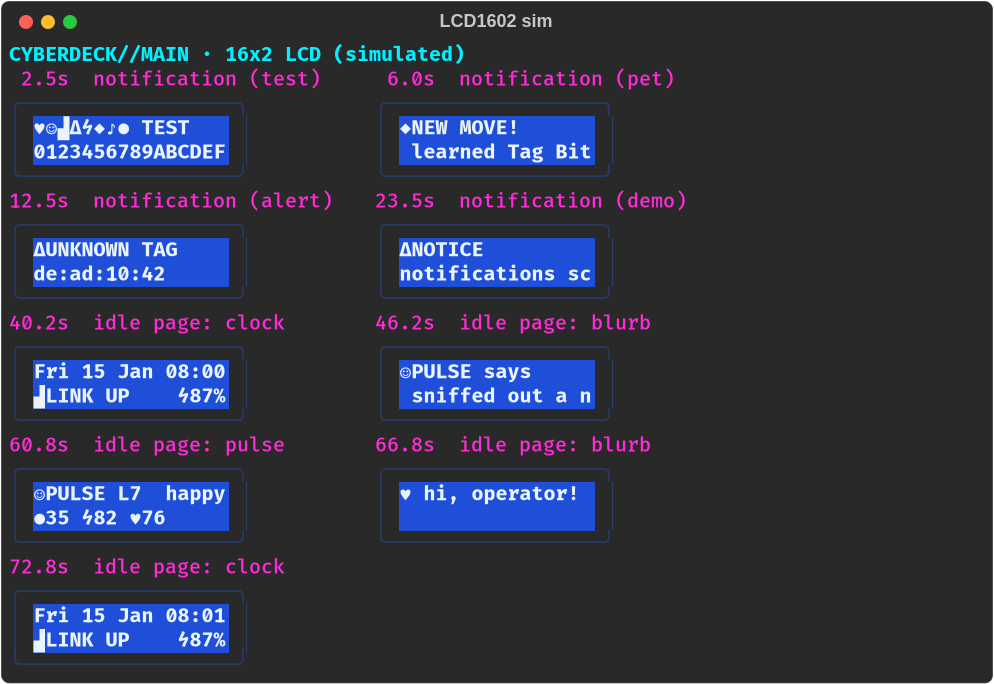
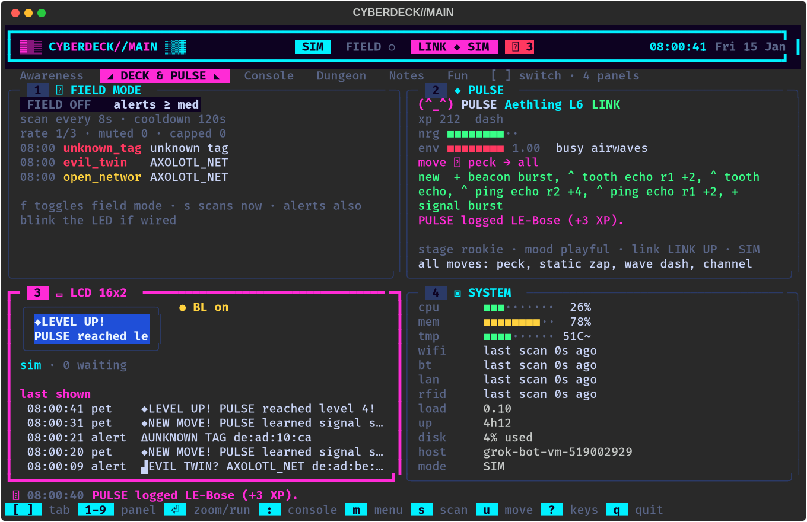

# The 16x2 LCD: PULSE blurbs and notifications

The main deck can drive a small **LCD1602** character screen (16 characters x
2 lines) with an **I2C backpack** (the little PCF8574 board soldered to its
back). While you work, it rotates through PULSE's status, PULSE's own lines
and a clock. When something happens it interrupts with a short notification
and blinks its backlight:

- **Awareness alerts**: a possible evil twin, an unknown RFID tag, an open or
  bait-named Wi-Fi network, a new LAN host, a Bluetooth device that lingers.
  These pass the same field-mode filter as the alert line.
- **PULSE news**: hungry, tired, ready to evolve (pick a form), evolving,
  evolved, level up, learned a move, a move got stronger, woke up.
- **The companion link** dropping or coming back, and **low deck battery**
  (when a battery gauge is fitted).
- Your own text: `lcd say hello`.



Until you plug the screen in, it is **simulated**. You see it as the
**LCD 16x2** tile in the **Deck & PULSE** tab. Switching to the real screen
is one line in `config/lcd.ini`.



---

## 1. Try it on your computer

```bash
python3 -m cyberdeck                  # Deck & PULSE tab -> the LCD 16x2 tile
python3 -m cyberdeck.lcd --demo       # just the LCD, drawn in this terminal (Ctrl+C stops)
python3 -m cyberdeck --lcd-sim        # also writes the screen to data/lcd_screen.txt
watch -n 0.3 cat data/lcd_screen.txt  # (in another window) follow it as text
python3 -m cyberdeck --headless --lcd-sim --script "lcd say hello"   # prints the screen after each command
```

In the console (`:` jumps there):

| command | what it does |
| --- | --- |
| `lcd` or `lcd status` | backend, backlight, the screen, what is waiting, what was skipped and why |
| `lcd test` | all 8 custom symbols and a 16-character ruler, then a scrolling line, with a backlight blink |
| `lcd say <text>` | show your own text right now (long text scrolls) |
| `lcd backlight on`, `off` or `auto` | force the backlight, or go back to automatic |
| `lcd next` | skip to the next idle page |
| `lcd clear` | drop waiting notifications |
| `lcd reload` | re-read `text/lcd_blurbs.txt` after you edit it |

It works the same in `--classic`, where `lcd` is also a pane for the split or
tab view in `config/layout.ini`, and in `--headless`.

---

## 2. Wiring (Pi Zero 2 W)

The backpack has 4 pins. With the Pi's 40-pin header:

| backpack pin | Pi pin | what |
| --- | --- | --- |
| **GND** | pin 6 (or 9, 14, 20…) | ground |
| **VCC** | pin 2 or pin 4 | **5 V** (the LCD backlight and contrast need 5 V) |
| **SDA** | pin 3 (GPIO2) | I2C data |
| **SCL** | pin 5 (GPIO3) | I2C clock |

```
 Pi header (top-left corner, SD card to the left)
   pin 1  3.3V  o o  5V    pin 2   <- VCC
   pin 3  SDA   o o  5V    pin 4   (or VCC here)
   pin 5  SCL   o o  GND   pin 6   <- GND
```

**5 V backpack, 3.3 V Pi.** The Pi's I2C pins are 3.3 V only. A PCF8574
backpack powered from 5 V is almost always fine: the Pi drives the lines low
and pulls them up to 3.3 V on its own, and 3.3 V reads as "high" for the
PCF8574. The catch: some backpacks have their **own pull-up resistors to 5 V**
on SDA and SCL, usually 4.7 kΩ marked "472", which would push 5 V back into
the Pi. If yours has them, either remove those two resistors or put a small
I2C level shifter between the Pi and the backpack. Most cheap LCD1602
backpacks work directly, and many people run them this way.

The companion board's UART (pins 8 and 10) and the RFID reader on SPI
(pins 19, 21, 23, 24) don't clash with I2C on pins 3 and 5.

---

## 3. Turn on I2C and find the address

```bash
sudo raspi-config            # Interface Options -> I2C -> Yes, then reboot
sudo apt install -y i2c-tools
i2cdetect -y 1
```

`i2cdetect` prints a grid. Your backpack shows up as **27** (PCF8574) or **3f**
(PCF8574A):

```
     0  1  2  3  4  5  6  7  8  9  a  b  c  d  e  f
20: -- -- -- -- -- -- -- 27 -- -- -- -- -- -- -- --
```

If the grid is empty, check the wiring (SDA and SCL swapped is the classic
mistake). If you get `Error: Could not open file /dev/i2c-1`, I2C isn't
enabled yet.

The deck can check for you too: `python3 -m cyberdeck.lcd --scan`.

---

## 4. Install the libraries and switch it on

```bash
pip install -r requirements-pi.txt     # RPLCD + smbus2 (on Bookworm: use a venv)
```

`config/lcd.ini`:

```ini
[lcd]
backend = i2c

[i2c]
address = auto        ; or 0x27 / 0x3F from i2cdetect
port = 1
```

Then test the screen on its own, and after that run the deck:

```bash
python3 -m cyberdeck.lcd --demo --backend i2c       # 40-second show on the real screen
python3 -m cyberdeck.lcd --say "hello world" --backend i2c --address 0x27
python3 -m cyberdeck --lcd i2c                      # one-off, without editing lcd.ini
```

If RPLCD isn't installed, the deck uses a small built-in driver on top of
`smbus2`. If the screen can't be opened, the deck keeps running on the
simulated copy, and `lcd status` and the tile show the error.

### The screen lights up but shows nothing, or a row of solid blocks

Turn the **blue contrast potentiometer** on the back of the backpack with a
small screwdriver while the deck is running. One row of solid blocks means
the contrast is too high, or the screen never got initialised (check the
address). A lit screen with nothing on it means the contrast is too low.

### Odd characters

`\` and `~` look different on most LCD1602 chips (the "A00" ROM shows `¥`
and `→`), so the deck swaps them for `/` and `-`. If accented letters look
wrong, try `charmap = A02` under `[i2c]`.

---

## 5. What shows when

- **Priorities:** 1 info, 2 notice (PULSE news, link up), 3 alert (evil twin,
  unknown tag, link down, low battery, PULSE ready to evolve). A higher one
  interrupts a lower one, and the interrupted message gets one more turn
  afterwards. Your `lcd say` / `lcd test` always shows.
- **Notifications** hold for `hold_seconds` (alerts for `alert_hold_seconds`),
  or long enough to scroll once. With `chirp = yes` the buzzer chirps for
  alerts.
- **Long text:** if it fits on 2 lines it is word-wrapped. Otherwise line 2
  scrolls like a ticker under a title.
- **Calm-down rules:**
  - The same message within `dedupe_seconds` is skipped.
  - Info and notices are limited to `max_per_minute`. Alerts are never
    dropped for rate.
  - **Field mode** (`f`) only lets alerts through.
  - **Quiet hours** (`[quiet]`, local time on the deck, off by default) only
    let alerts through, without blinking or chirping, and keep the backlight
    off in between.
  - Everything skipped is listed by `lcd status` and in the zoomed tile
    (Enter).
- **Idle pages** (`[pages] order`):
  - `pulse`: name, level, mood, food, energy and happiness.
  - `blurb`: PULSE's recent reactions first, such as "PULSE logged AirPods
    (+3 XP).", then flavour lines for its mood.
  - `clock`: the time, the link and the battery.

### The 8 custom symbols

The HD44780 chip has room for 8 home-made 5x8 characters. The deck uploads:
heart, PULSE's face, Wi-Fi bars, bell, lightning bolt, diamond, music note,
and food. Text that contains `♥ ◆ ⚡ 🔔 📶 ♪ 🍖` (and similar) is mapped to
them automatically. Other emoji are dropped and accents are removed
(é → e). The pixel art is in `GLYPH_ART` at the top of `cyberdeck/lcd/text.py`.
Edit the `#` and `.` rows to redraw a symbol.

---

## 6. Make it yours

- **PULSE's lines:** `text/lcd_blurbs.txt`. Lines are grouped by mood
  (`[happy]`, `[hungry]`, `[sleeping]`…, plus `[any]`). Fill-ins: `{name}
  {level} {mood} {species} {hunger} {energy} {happiness}`. Symbols: `{heart}
  {face} {wifi} {bell} {bolt} {diamond} {note} {food}`. Save, then type `lcd
  reload`.
- **Which PULSE events pop up:** `config/lcd.ini [notify] pet_events`.
  Events you remove still become blurbs.
- **Titles and priorities per event:** `PET_TITLES` and `ALERT_TITLES` at the
  top of `cyberdeck/lcd/service.py`.
- **Timing, flash, chirp, quiet hours, dedupe:** `config/lcd.ini`. Every key
  is commented.
- **A different size** (for example a 20x4 LCD2004): set `cols = 20` and
  `rows = 4`.

## How it fits together

```
 deck (any front end)                     LcdService (cyberdeck/lcd/service.py)
 ├─ pet watcher events ──EVENT_HOOKS──▶   notify()  ─▶ NotifyQueue (dedupe, rate,
 ├─ awareness alerts (Rich UI) ────────▶   notify()      field mode, quiet hours)
 ├─ pet.discovery.ok reactions ────────▶   add_blurb()/notify()
 └─ ui_tick: pet status, link, battery ▶   set_pet()/set_link()/set_battery()
                                            │
                    background thread, 4x a second: tick()
                    queue -> notification, else idle page (pulse / blurb / clock)
                    marquee + backlight flash -> SimScreen (tile, lcd_screen.txt)
                                              -> I2cLcd (RPLCD or smbus2), changed lines only
```

Files: `cyberdeck/lcd/` (`text.py`, `messages.py`, `pages.py`, `backends.py`,
`service.py`, `settings.py`, `__main__.py`), `cyberdeck/features/lcd.py`
(commands, pane, hooks), `cyberdeck_dash/ui/lcd_panel.py` (the tile),
`config/lcd.ini`, `text/lcd_blurbs.txt`. Tests: `tests/test_lcd.py`,
`tests/dash/test_lcd_tile.py`.
